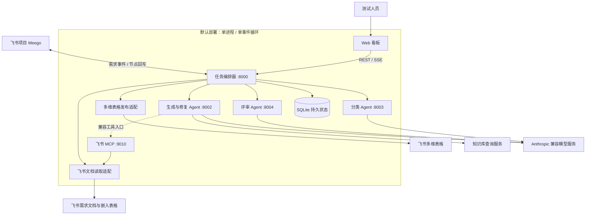
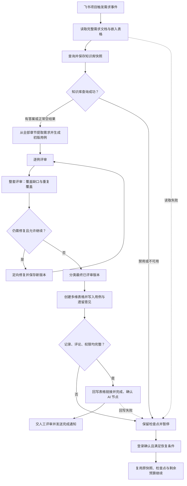

# Agentic Test

将需求转成可评审测试用例的 QA Agent 框架，支持持久化任务、有界修复和人工交接。

## 包含的能力

- 从需求提取测试范围，生成结构化用例，进行逐例和整套评审、定向修复与分类。
- 通过 SQLite 检查点恢复任务，限制模型尝试、token 预算和并发。
- 提供 Agent 通信、看板、任务进度与脱敏追踪。
- 通过飞书读取需求、发布多维表格并回写 Meego 节点；同时保留其他测试管理适配器。
- 保留单元测试、外部边界 mock、Docker 构建文件和 CALM 架构校验。

## 架构设计

默认通过 `scripts/start_all.py` 在单进程、单事件循环内启动编排器、生成、评审、分类和飞书 MCP 服务。外部模型、知识库与飞书租户由使用者自行接入。



编排器负责读取完整需求、调度各 Agent、发布表格并回写节点；知识库由生成 Agent 查询。持久化开启后，SQLite 保存任务状态、阶段检查点、用量与发布记录。飞书 MCP 是兼容工具入口；当前持久化主流程直接调用文档读取适配，并向各阶段传递固定快照，不让模型重复读取需求。

图示聚焦默认的用例生成链路；独立需求评审、OSS 归档，以及其他测试管理和测试执行入口未展开。可校验的架构模型见 [CALM 说明](calm/README.md)。

## 用例生成流程



- **评审与修复**：每轮先逐例评审，再检查整套覆盖与重复覆盖。默认最多三次完整评审、两次修复，最后交付的版本必须已评审。收敛、达到轮数、无进展，或修复尚未发起且需要预留收尾预算时，进入分类与交付，并保留最终未解决意见供人工处理。
- **正常空结果与异常**：知识库查询成功但没有匹配内容，正常继续；禁用或不可用会暂停。文档读取不完整、模型结果或用量不明确，以及发布、节点回写失败，也不能视为交付完成。
- **确认续跑**：图中的暂停与恢复依赖持久状态配置。网页续跑还需启用对应入口，并满足原截止时间、剩余预算、配置一致性及请求计费状态等条件；登录确认后复用原快照与检查点，不会自动重跑所有步骤。

## 接入边界

当前是需要自行接入服务的框架版本，尚未验证面向公网服务的完整部署。已知依赖与静态扫描风险见 [SECURITY.md](SECURITY.md)。仓库不包含内部环境地址、凭据、真实需求与原私有提交历史。

1. **模型服务**：使用 Anthropic 兼容协议。为兼容现有代码保留 `PHOTON_*` 变量名；模型别名须按自己的服务配置，不能假设默认别名在公开模型服务上可用。未知失败不会自动按确定未计费处理。
2. **知识库**：需要实现 README 中约定的查询接口。成功但答案为空会继续生成；禁用或不可用会阻断持久化生成流程，不能简单关闭后运行。边界 mock 仅用于测试。
3. **飞书权限**：需配置自己的应用、`lark-cli` 机器人身份和文档、表格权限。**生成表格默认允许本租户内持链接的人编辑**，使用前应核对这一权限范围。
4. **Meego 模板**：需配置自己的项目、节点和字段 ID，仓库中的默认标识均为示例。

需求评审和 OSS 归档默认关闭。达到评审轮次上限后交人工处理剩余意见，任务完成不表示所有质量问题通过。提示词注入检测默认关闭，不可信资料处理规则也不能保证阻断所有攻击。

## 本地准备

需要 Python 3.14、uv；UI 和 CALM 需要 Node.js 20+；飞书读取、发布还需要 `lark-cli`。

```bash
uv sync --frozen
cp .env.example .env
# 填入自己的模型、知识库、飞书和认证配置。
uv run python -m scripts.start_all
```

看板端口为 8000。持久化任务需要配置可写的 `DESIGN_STATE_DIR` 并在重启时复用该目录，按单实例运行。Docker 构建、持久卷挂载与校验命令见英文 README。Helm 是高级部署模板，不能在未配置持久卷时宣称支持恢复。

普通单元测试无需真实服务，真实模型 smoke 仅手动触发并产生费用。

```bash
uv run ruff check .
uv run pytest tests/ -m 'not smoke and not live_llm'
```

遵循 [AGPL-3.0-only](LICENSE)。本地模型权重未随源码分发，需分别遵守其许可。
